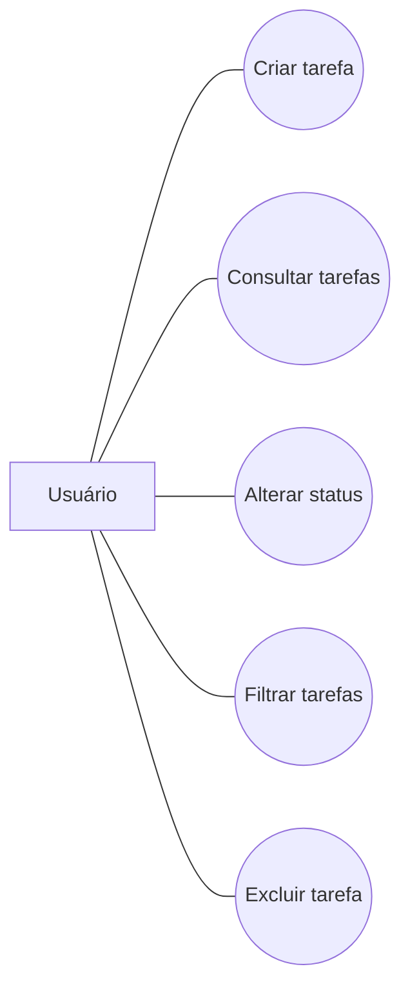
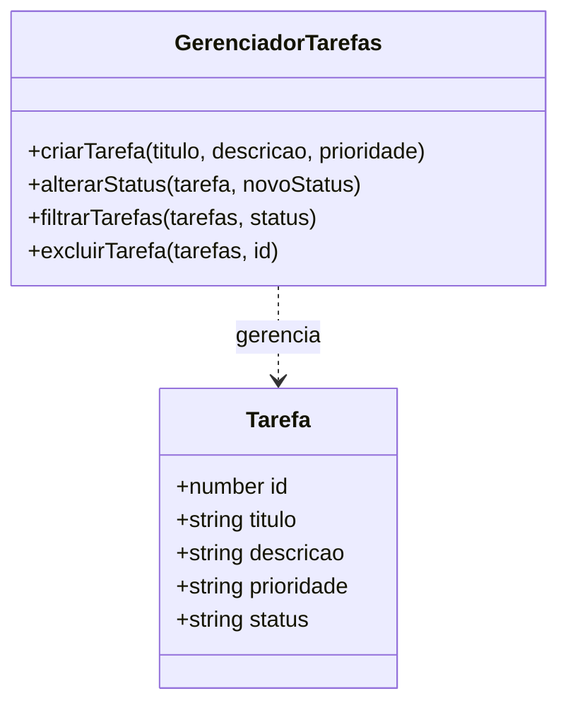

# Gerenciador de Tarefas — TechFlow Solutions

## 1. Sobre o projeto

O Gerenciador de Tarefas foi desenvolvido como projeto acadêmico de Engenharia de Software para demonstrar conceitos de metodologias ágeis, organização de atividades, testes automatizados e integração contínua.

## 2. Objetivo

Permitir a organização de tarefas por status, facilitando o acompanhamento das atividades de uma equipe.

## 3. Funcionalidades

- Criar tarefas com título, descrição e prioridade.
- Validar o título das tarefas.
- Alterar o status de uma tarefa.
- Filtrar tarefas por status.
- Excluir tarefas.
- Executar testes automatizados com Jest.

## 4. Tecnologias utilizadas

- HTML, CSS e JavaScript.
- Node.js e npm.
- Jest para testes automatizados.
- GitHub para versionamento do código.
- GitHub Actions para integração contínua.

## 5. Metodologia ágil

O projeto utiliza conceitos do método Kanban, com organização das atividades nas etapas To Do, In Progress e Done. As tarefas são acompanhadas conforme o andamento do desenvolvimento.

## 6. Testes automatizados

Os testes são escritos com Jest e verificam a criação de tarefas, validação de títulos, alteração de status, filtragem e exclusão.

Para executar os testes localmente, instale o Node.js e execute:

```bash
npm install
npm test
```

## 7. Integração contínua

O GitHub Actions executa os testes automaticamente quando há alterações enviadas ao repositório ou solicitações de integração.

## 8. Mudanças de escopo

As mudanças de escopo devem ser registradas no quadro Kanban, implementadas por meio de commits e descritas nesta documentação conforme forem realizadas.

## 9. Estrutura do projeto

- `index.html`: interface web do gerenciador.
- `src/app.js`: funções principais do sistema.
- `tests/app.test.js`: testes automatizados.
- `docs/README.md`: documentação complementar.
- `.github/workflows/testes.yml`: configuração da integração contínua.
- `package.json`: configuração do projeto e dependências.


## Diagrama UML de casos de uso

O diagrama representa as principais ações que o usuário pode realizar no gerenciador de tarefas.




## Diagrama UML de classes

O diagrama apresenta a estrutura da tarefa e as operações utilizadas no sistema.




## 10. Mudança de escopo

Durante o desenvolvimento do projeto, foi identificada a necessidade de facilitar a localização de tarefas cadastradas. Por isso, o escopo foi ampliado para incluir uma funcionalidade de busca por título.

A nova função permite pesquisar tarefas utilizando parte do título, sem diferenciar letras maiúsculas de minúsculas. Quando o campo de busca está vazio, todas as tarefas são retornadas.

### Justificativa da mudança

A funcionalidade foi adicionada para melhorar a usabilidade e tornar mais rápido o gerenciamento das tarefas.

### Implementação e controle de qualidade

A função foi implementada em `src/app.js` e exportada para utilização nos testes automatizados. Foram adicionados testes para verificar a busca por título e o comportamento quando o termo de busca está vazio.

Os testes são executados pelo GitHub Actions a cada alteração enviada ao repositório.

### Registro da mudança

- Cartão Kanban: Adicionar busca de tarefas por título.
- Commit de implementação: `feat: adiciona busca de tarefas por título`.
- Commit de testes: `test: adiciona testes para busca de tarefas`.
- Validação: execução dos testes automatizados com resultado aprovado.
